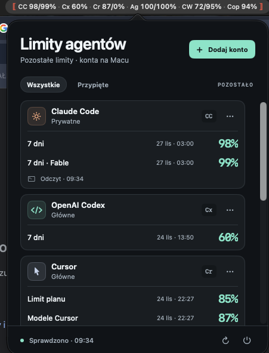

# QuotaRail


**Procenty limitów agentów w jednym miejscu na pasku menu macOS.**

[Pobierz QuotaRail dla macOS](https://github.com/PopLogic-pl/quotarail/releases/latest/download/QuotaRail-macOS.zip) · [Wydania i sumy kontrolne](https://github.com/PopLogic-pl/quotarail/releases)

QuotaRail to publiczne demo interfejsu. Zaczyna od pustych wskazań. W panelu można włączyć stałe, przykładowe procenty dla Claude Code, Codex, Cursor, Antigravity i GitHub Copilot. Demo działa offline i nie wymaga logowania.

## Podgląd

Zrzuty z pełnej wersji pokazują wygląd, na którym opiera się demo.




## Instalacja

1. Pobierz `QuotaRail-macOS.zip` z sekcji [Releases](https://github.com/PopLogic-pl/quotarail/releases) i rozpakuj plik.
2. Przenieś `QuotaRail.app` do **Aplikacji** (`/Applications`). Na macOS 27 ma to znaczenie, jeśli używasz Hidden Bar.
3. Otwórz aplikację. Kliknij tekst między czerwonymi nawiasami na pasku menu, aby zobaczyć panel.
4. Włącz **Pokaż przykładowe limity**, aby zobaczyć przykładowe wartości. Przycisk zasilania zamyka aplikację.

Paczka wymaga macOS 13 lub nowszego i zawiera binaria dla Apple Silicon i Intel. Jest podpisana lokalnie, bez notaryzacji Apple. macOS może wyświetlić komunikat przy pierwszym otwarciu. Możesz również zbudować aplikację lokalnie. [Pomoc Apple](https://support.apple.com/pl-pl/102445).

## Budowa i dostosowanie

Zainstaluj narzędzia Xcode Command Line Tools poleceniem `xcode-select --install`. Następnie uruchom poniższe polecenia w Terminalu.

```sh
git clone https://github.com/PopLogic-pl/quotarail.git
cd quotarail
./Scripts/build-app.sh
```

Skrypt zapisuje `dist/QuotaRail.app` i `dist/QuotaRail-macOS.zip`. Skopiuj aplikację do `/Applications` i otwórz ją z Findera. Etykiety, przykładowe wartości i panel możesz edytować w [`QuotaRail.swift`](Sources/QuotaRail/QuotaRail.swift).

Publiczna wersja obejmuje pasek, panel i dane przykładowe. Kod jest dostępny na [licencji MIT](LICENSE).
