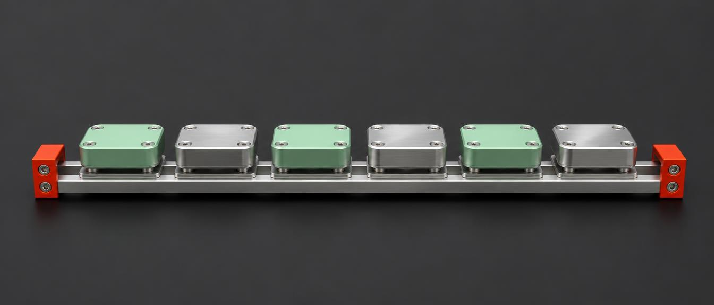

# QuotaRail



See how much of your Claude Code, Codex, Cursor, Antigravity, and GitHub Copilot quotas you have left in the macOS menu bar. Add the accounts you want to track. Give each account a name and a short label.

**[Download QuotaRail for macOS](https://github.com/PopLogic-pl/quotarail/releases/latest/download/QuotaRail-macOS.zip)** · [Releases and checksums](https://github.com/PopLogic-pl/quotarail/releases)


## Install

1. Extract `QuotaRail-macOS.zip` and move `QuotaRail.app` to `/Applications`.
2. Open QuotaRail and click **Add account**. The account list starts empty.
3. Choose a provider, enter a name, and select the profile or sign-in you want to use. Save and check the result in the panel.

QuotaRail requires macOS 13 or later. The ZIP contains Apple Silicon and Intel builds in one app. We sign the app ad hoc and ship it without Apple notarization. macOS may ask you to approve the first launch. [Apple’s guide to opening downloaded apps](https://support.apple.com/en-us/102445).

Keep QuotaRail in `/Applications` if you use Hidden Bar on macOS 27. The system can hide menu items from apps launched outside that folder. [Hidden Bar’s report](https://github.com/consolelabs/hidden/pull/533).

## Connect accounts

| Provider | First account | Additional accounts |
| --- | --- | --- |
| **Claude Code** | Sign in with `claude auth login`. Leave the profile folder blank. Use Claude Code 2.1.316 or later for `/usage`. | Sign in with `CLAUDE_CONFIG_DIR="$HOME/.claude-work" claude auth login`. Select `~/.claude-work` in QuotaRail. Use a different folder for each account. |
| **OpenAI Codex** | Sign in with `codex login` and leave the folder at `~/.codex`. | Run `CODEX_HOME="$HOME/.codex-work" codex login`, then select `~/.codex-work`. Use a different folder for each account. |
| **Cursor** | Sign in to Cursor. Leave the profile file and token fields blank to use your local session. | Select a separate `auth.json` or `state.vscdb` file, or enter the other account’s `WorkosCursorSessionToken`. |
| **Antigravity** | Sign in to `agy` 1.1.11 or later and confirm that `/usage` works. Set the home folder to `~`. | Sign in to `agy` with a separate `HOME`, `XDG_CONFIG_HOME` inside it, and `SSH_TTY=/dev/null`. Select that home folder in QuotaRail. |
| **GitHub Copilot** | Sign in with `copilot login` or `gh auth login`. Leave the token field blank. | Enter a GitHub token for the other account with Copilot access. |

If Claude Code cannot return `/usage`, open the account editor and click **Copy Claude Code configuration**. Add the `statusLine` entry to that profile’s `settings.json`. If you use a status line script, pass its input JSON to QuotaRail from the script. [Claude Code status line docs](https://code.claude.com/docs/en/statusline).

QuotaRail keeps account settings on your Mac and stores tokens you paste in macOS Keychain. It reads quotas for the accounts you add. Claude Code and Codex support several profiles. Cursor, Antigravity, and Copilot support up to two accounts each.

## Read the menu bar

Each number shows the percentage **remaining**. A slash separates two quota windows or pools. Click the bar to see their names and reset times. Use the account settings to pick which accounts appear in the bar.

- **Claude Code** shows the weekly quota and Fable where the default profile reports it. Separate profiles show 5-hour and weekly quotas.
- **Codex** shows its primary quota. **Cursor** shows Cursor models and external models when those pools are available.
- **Antigravity** shows the 5-hour and weekly Gemini quotas. **Copilot** shows the premium quota reported for the account.

QuotaRail checks configured accounts every three minutes. Click the refresh icon to check sooner. A dash means the app has no current reading for that quota. Open the panel to check for a sign-in or connection error.

## Language

QuotaRail supports English and Polish. To choose a language for the app, open **System Settings → General → Language & Region → Applications**, add QuotaRail, and select **English** or **Polish**. Quit and reopen the app to apply the change. [Apple’s language settings guide](https://support.apple.com/guide/mac-help/change-the-language-your-mac-uses-mh26684/mac).

## Build from source

Install the Xcode Command Line Tools with `xcode-select --install`, then run:

```sh
git clone https://github.com/PopLogic-pl/quotarail.git
cd quotarail
./Scripts/test.sh
./Scripts/build-app.sh
```

The build creates `dist/QuotaRail.app` and `dist/QuotaRail-macOS.zip`.

[MIT license](LICENSE).
